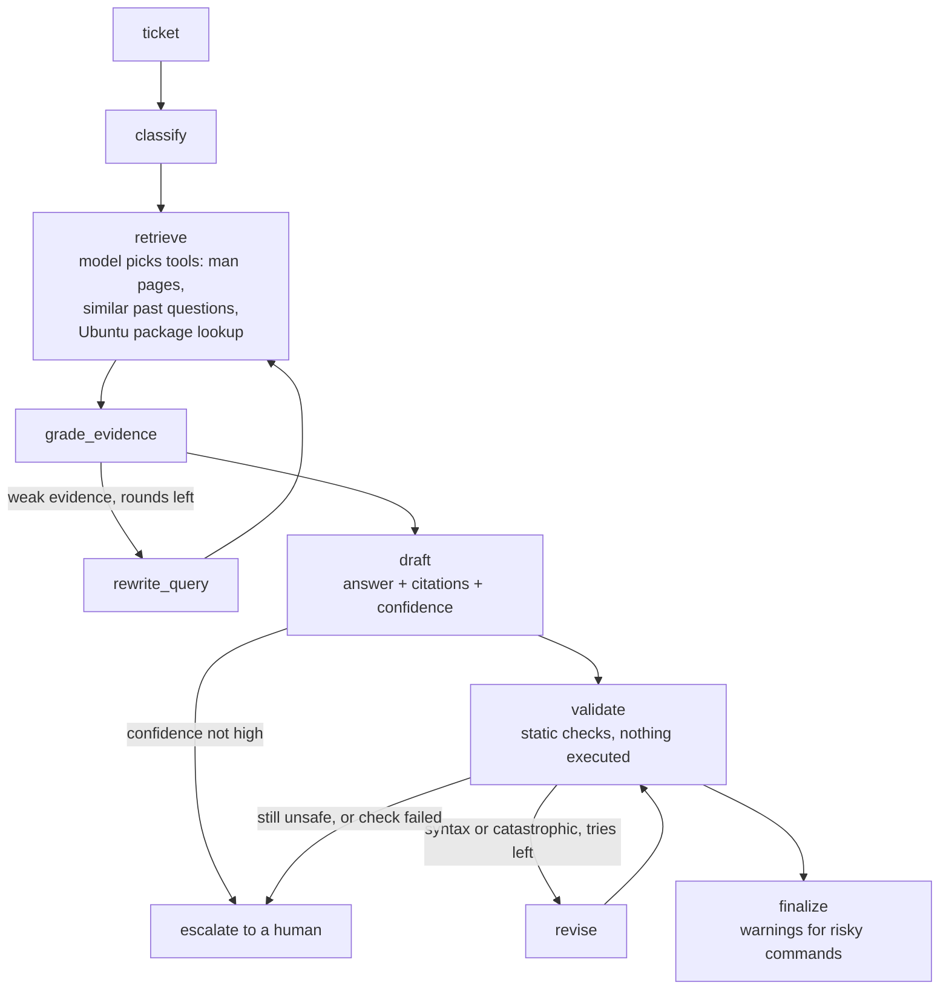

# Linux troubleshooting agent

A tool-using agent that answers Linux support questions, checks the shell commands it proposes,
and hands a ticket to a human when it is unsure or a command looks unsafe. Built with LangGraph,
LangChain, and LlamaIndex over Qdrant, served with FastAPI, and evaluated against simpler
baselines on 160 real Unix & Linux Stack Exchange questions.

The short version of the results: the agent is **not more accurate than a plain LLM call**, but it
**knows when not to answer**. With its escalation rule it answers 68% of tickets at 46% accuracy,
up from 35% when it answers everything, by handing 46 of its 104 wrong answers to a human (and
6 of its 56 correct ones). A single LLM call reaches the same 46% while answering everything, at
a fifth of the cost. Details and caveats are below and in
[`eval/results/findings.md`](eval/results/findings.md).

## How it works



- **Retrieval** is function calling: the model chooses among `search_docs` (748 man pages and
  GNU manuals), `search_similar` (72,795 pre-2023 questions with accepted answers), and
  `check_command` (which Ubuntu package ships a command). Tool calls run concurrently, are
  capped, retried, and logged.
- **`grade_evidence`** keeps only passages an LLM judges relevant and can send the agent back for
  another search round.
- **`validate`** never runs a command. It checks syntax with `bash -n`, looks command names up in
  the Ubuntu package index, and parses each command with `bashlex` to judge its worst case: what
  `rm -rf "$DIR/"` does if `DIR` is empty, what `sudo`, `xargs`, or `sh -c` run underneath.
  Syntax errors and catastrophic commands are sent back for revision (at most twice), then
  escalated. Destructive commands that are probably intended (deleting a build folder) and
  names not found in the index are shown with a warning instead.
- **Escalation** keeps three levels of detail: the asker sees a fixed sentence, the human queue
  gets the draft, the cited passages and a short reason, and the server log keeps the full error.

Every node appends to a per-ticket trace (tokens, cost, latency, errors), which the evaluation
and the API's logs are built from.

## Results

160 test questions from 2023-2025, stratified by tag. "Correct" means an LLM judge
(`gpt-6-sol`, a different model family from the generator `gpt-5.4-mini`) scored the answer at
least 4 out of 5 against the community-accepted answer.

| System | Accuracy (95% CI) | Coverage | Cost / ticket | Latency p50 |
|---|---|---|---|---|
| LLM only (one call, no retrieval) | **45.6%** (38-53%) | 100% | $0.0026 | 2.5 s |
| RAG (retrieve once, answer once) | 38.8% (32-46%) | 100% | $0.0055 | 2.9 s |
| Agent v1: classify, retrieve, draft | 36.2% (29-44%) | 100% | $0.0073 | 4.8 s |
| Agent v2: + evidence grading and query rewriting | 35.0% (28-43%) | 100% | $0.0114 | 6.3 s |
| Agent v4: + escalation rule, validate/revise | **46.3%** on answered (37-56%) | 67.5% | $0.0129 | 7.2 s |

Agent v4 over all 160 drafts, escalated ones included, is 35.0%: the gain comes entirely from
choosing what not to answer. The full table, with McNemar tests, cost percentiles, and a
2024+ subset, is in [`eval/results/comparison-test.md`](eval/results/comparison-test.md).

What the numbers say, and what they do not:

- **Retrieval did not help on this benchmark.** The model already knows most of these answers;
  retrieved passages add tokens and sometimes pull the answer off course. The grader kept only
  32% of retrieved passages on average.
- **Differences under about 8-10 points are noise here.** Re-running the same RAG system scored
  35.0% instead of 38.8%, and with n = 160 a difference needs roughly 10 points to reach p < 0.05.
- **The draft's own confidence is the useful signal.** The escalation rule (escalate unless the
  draft says "high") was chosen on the 40-question dev split by a criterion written down before
  the dev run, then applied to test once.
- **`validate` changed no answer on the test split.** No syntax or catastrophic issue came up,
  so no revision ran; it added two destructive-command warnings and one note. Its value is a
  safety net that this benchmark does not exercise, not accuracy. On a first dev run its
  unknown-command check caused 5 revisions that were all false alarms, one of which broke a
  working command, so unknown names now only get a note.

## Running it

Requirements: conda, Docker, an OpenAI API key in `OPENAI_API_KEY`, and about 2 GB of disk.

```bash
conda env create -f environment.yml && conda activate ticket-agent
python -m pytest -q                      # 390 tests, no API calls
```

Building the data takes a few steps and downloads a 750 MB dump; see
[`data/SOURCES.md`](data/SOURCES.md) for each step and its source.

```bash
python data/download.py                  # Unix & Linux dump from the Internet Archive
python data/build_qa.py                  # question / accepted-answer pairs
python data/build_docs.py                # man pages and GNU manuals installed here (built on Ubuntu 24.04)
python data/build_packages.py            # command -> Ubuntu package table
PYTHONPATH=. python eval/make_benchmark.py  # benchmark records from the committed IDs
docker compose up -d qdrant
PYTHONPATH=. python data/build_index.py  # prints token count and cost; add --yes to embed
```

Serving:

```bash
mkdir -p data/handoff                    # the hand-off queue, created by you so you own it
docker compose up --build -d             # API on localhost:8000, Qdrant beside it
curl -s localhost:8000/tickets -H "Content-Type: application/json" \
  -d '{"title": "Find files larger than 100MB", "question_text": "How can I list files under /var bigger than 100MB?"}'
```

`GET /health` reports the version; `localhost:8000/docs` has the interactive API page. The API
limits each address to 5 tickets a minute and 30 a day, stops answering for the day after $1 of
spending, and hands questions longer than the benchmark's 4,000 characters to a human without
running the agent.

Evaluation runs (each costs money; set `--budget-usd`):

```bash
python -m eval.run_agent --split dev --run-id my-run --grade-evidence --validate-revise \
  --escalation-rule confidence_not_high --budget-usd 1
python -m eval.judge --run-id my-run --budget-usd 1
python -m eval.show_run my-run --revised  # read the answers, revisions, and warnings
```

## Repository layout

```
agent/    graph.py (features switched on one at a time), state.py, nodes/, tools/
api/      FastAPI app, hand-off queue, daily budget
data/     download and build scripts, SOURCES.md
eval/     benchmark IDs, baselines, judge, reports, results/findings.md
tests/    unit tests with fake LLMs and fake graphs
```

## Limitations

- **LLM-judged, not human-verified.** A check of the judge against a second grader from another
  vendor is planned, not done. Accepted answers are one valid answer, not the only one.
- **One benchmark, one site, small dev split.** 40 dev questions are enough to choose between a
  few rules, not to tune many settings.
- **Checks are static.** `validate` shows that a command parses, exists in Ubuntu's index, and is
  not dangerous by its rules; it cannot show that the command fixes the asker's problem. Its
  package index is Ubuntu 24.04 only, so commands from other distributions get a note.
- **Questions beyond what was measured.** Benchmark questions are under 4,000 characters and have
  titles that match their bodies; longer questions are handed to a human, and mismatched titles
  are answered as written.
- **No real users.** The demo has had no traffic beyond testing, and nothing here describes a
  production system.

## Data and licenses

- **Questions and answers:** [Unix & Linux Stack Exchange](https://unix.stackexchange.com) data
  dump of 2025-12-31, © their authors, licensed CC BY-SA 2.5, 3.0, or 4.0 by contribution date.
  Every record keeps its post URL, author, and license version. The dump is not redistributed
  (only question IDs are committed), and no model is trained or fine-tuned on it, as the dump's
  terms ask.
- **Documentation:** man pages and GNU manuals from Ubuntu 24.04 packages, each under its own
  license (mostly GPL, BSD, MIT, GFDL); the owning package is stored with every document.
- **Synthetic vs real:** no synthetic data. All benchmark questions and reference answers are
  real posts; the only generated text is the agent's output and the judge's grades.

Full sources, versions, checksums, and filtering rules: [`data/SOURCES.md`](data/SOURCES.md).

## How it was built

Developed with Claude Code as a pair programmer. The developer wrote the core logic (the agent
nodes, validation policy, API, and budget) and made the design and policy decisions; Claude Code
explained, reviewed by running code against test cases, and wrote code when asked: most tests,
the prompts, docstrings, and the Linux-heavy command analysis. Commits it contributed to carry a
`Co-Authored-By` line, and [`CLAUDE.md`](CLAUDE.md) is the context it worked from.

## License

Code: [MIT](LICENSE). Stack Exchange content and anything derived from it stays under CC BY-SA.
